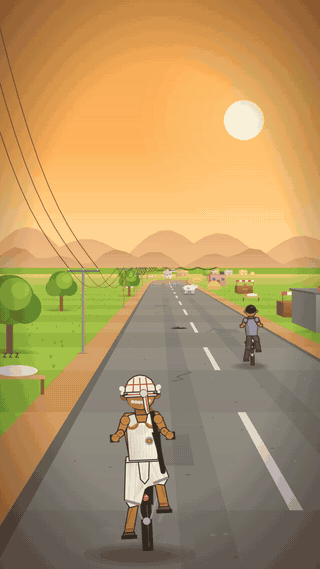

# Dhoti Dash

<p align="center"><a href="https://ahab94.github.io/dhoti-dash/"></a></p>

<p align="center"><b><a href="https://ahab94.github.io/dhoti-dash/">▶ Play free in your browser</a></b> (phones too)</p>

**Chacha Jee is 72. He has a white dhoti, a black chhatri, a heavy old roadster cycle and a list of errands. Everyone else on the road is in his way.**

A satirical desi combat-cycling game in the spirit of 90s road-brawl racers:
- Ride the village roads in fake 3D, brawling with the mohalla's riders.
- Dodge cows, buffaloes, stray dogs and baraats.
- Escape the rishta aunty.
- Last man standing wins.

Made in Godot 4.7 with GDScript. Every picture and sound is made in code.

## Play

**▶ [Play in your browser](https://ahab94.github.io/dhoti-dash/)**. It works on phones, with on-screen controls.

Install with one line:
- **macOS / Linux:**
  ```bash
  curl -fsSL https://raw.githubusercontent.com/ahab94/dhoti-dash/main/install.sh | bash
  ```
- **Windows (PowerShell):**
  ```powershell
  irm https://raw.githubusercontent.com/ahab94/dhoti-dash/main/install.ps1 | iex
  ```

Or download a zip from the [latest release](https://github.com/ahab94/dhoti-dash/releases/latest).

## Controls

| Key | Action |
|---|---|
| Up / W | Pedal |
| Down / S | Brake |
| Left, Right / A, D | Steer |
| Space / J | Swing your weapon (it picks the nearest side) |
| B / K | Ring the bell (riders ahead move aside, dogs get startled, buffaloes don't care) |
| R | Retry · Esc: menu · Enter: next errand |

**On phones and tablets**, buttons appear automatically and Chacha pedals by himself:
- Left thumb: steer with **<** and **>**.
- Right thumb: **SWING**, **BELL**, and hold **REST** to coast and get your breath back.

## The game

Each race is one of Chacha's errands. Finish in the top three to unlock the next one.

| # | Errand | What's new |
|---|---|---|
| 1 | **Dahi Before Dark**: the dairy shuts at six | Pedalling, breath, potholes, puddles, chai |
| 2 | **The Bank Lunch Break**: lunch is 1 to 3, also 11 to 1 | Buffaloes, speed breakers, jalebi boost |
| 3 | **Mohalla Cricket Final**: Chacha is the umpire | Street-cricket balls across the road, donkey carts |
| 4 | **Rishta Aunty Season**: deliver the grandson's tiffin | A rishta aunty on a scooty chases you; watch the mirror |
| 5 | **The Baraat Is Coming**: late for the nephew's wedding | Wedding processions snaking across the road |
| 6 | **Last Date For The Bill**: the electricity bill queue | Master Jee, the boss rival, plus everything at once |

**Meters**
- **Rivals tire too.** They coast to get their breath back, and reckless ones run dry and pant: your chance to pass.
- **Breath** drains while you pedal hard and refills while you coast (downhills are free). Run out and Chacha pants at two-thirds speed until he recovers.
- **Back pain** rises with potholes, cricket balls, rival umbrellas and crashes. At 100 he is *retired hurt*.
- **Chai** refills breath and soothes the back. **Jalebi** gives a sugar rush: faster, and no breath needed.

**The brawl.** Everyone fights everyone, 90s road-brawl style:
- Rivals swing at Chacha and at each other, and the aggressive ones steer towards a fight.
- When a rider's back pain hits 100 they're **OUT** for the rest of the race, sitting on the verge under an umpire's OUT sign. A buffalo can do it too.
- Knock out every rival and you win on the spot: **last man standing**. Otherwise it's first over the line among those still riding.
- Knock a rival out and Chacha **grabs his weapon**.
- You can't hit the aunty ("Manners, Chacha!").

**Desi weapons** (damage, reach and swing speed differ):

| Weapon | Who carries it |
|---|---|
| Chhatri | Chacha |
| Rolled akhbaar | Pappu Paperwala |
| Doodh can | Bablu Doodhwala |
| Kadchi | Chintu Chaiwala |
| Chappal (the fastest) | Bunty |
| Belan | Guddu Tiffin |
| Jhaadu (the longest reach) | Tinku Tailor |
| Scale | Master Jee |
| Ganna and lauki (the heaviest) | roadside pickups |

**Village traffic:**
- A cow standing in the road who does not move (you bounce off: "Sorry, cow-ji!").
- Herds of goats, flapping hens and buffaloes.
- Stray dogs chase whoever rides past, rivals included. Lead one onto a rival and let it bite him instead.
  - Shake a dog off by outrunning it flat out (it's a bit slower than a sprinting cycle) or by weaving (it turns slower than you).
  - Or ring the bell (it startles) or swing at it (it runs off yelping).
- Bullock carts with bells, sugarcane tractors, vegetable thelas, brick piles, donkey carts and rickshaws.

**Cartoon effects:**
- Crash: a slide whistle down, a bonk, and dizzy birds tweeting.
- Knockout: a bonk.
- Cow: a boing as you bounce off.
- Speed breaker: a slide whistle up.
- Hits: a split-second hit-stop to sell them.

**Voices:** real recordings only, because synthesized speech had no emotion.
- Record the lines in `voices_in/LINES.txt` on a phone, drop them in `voices_in/`, and run `bash tools/import_voices.sh`. The game uses whatever lines exist.
- Planned lines: "O teri!", "Baap re!", "Hai meri kamar!", screams, the aunty's "Haaw!".

**Slow motion** is for recordings only (`--slowmo`). In play it felt like a penalty.

**Sound**, all synthesized by `python3 tools/make_audio.py`:
- Race music: a bhangra loop with dhol, tumbi, harmonium and shehnai.
- Menu music: a tabla keherwa with a sitar-ish pluck.
- Effects: the cycle bell, DHISHOOM punches, a buffalo moo, a chai clink, a tabla swoop over breakers, a tabla tihai for OUT, the TV-drama sting when the aunty catches you, and a sad shehnai for retired hurt.

**The look:** riders are flat, seen from behind. The world has depth: box buildings with side walls and rooftops, distance haze, a raised kerb, camera roll in bends, soft shadows, road grit and cracks, dust, speed streaks and a warm vignette.

**The tone:** affectionate everyday satire (bank lunch breaks, rishta aunties, wedding bands, rooftop water tanks, "HORN OK PLEASE"). No politics, religion or real names, and Chacha is the hero, never the joke.

## How it works

- `scripts/race.gd` holds the rules, with no drawing, so the tests and the bots run headless.
- `scripts/renderer.gd` draws it the classic way: project road segments with `scale = depth / distance`, fake bends by sliding each segment sideways, then paint far to near.
- Hazards move by fixed formulas of time (`hazard.gd`), so every one can be forecast exactly.
- `race.plan_lane()` tries 21 sideways positions and scores each by forecasting the hazards. The rivals, the aunty and the autopilot all use it.

## Checks

```bash
bash checks/verify.sh
```

It runs the smoke test, the gameplay tests, and the autopilot gate: the expert bot must finish every race in the top three.

```bash
godot --headless --path . --script res://tests/sim.gd -- --rookie
```

This is the difficulty curve. Five deliberately sloppy "rookie" riders try every race, and their average lag behind the winner should climb. Lag by race: 1.5, 1.7, 1.2, 6.4, 5.9 and 17.1 s. "near" (a rival on screen, alongside or just ahead) is 51–90% for the expert bot.

## Roadmap

- [x] v0.1: 6 errands, 7 rivals, aunty chase, umbrella and bell, breath and back pain, menu and saves, touch buttons, autopilot gate, rookie difficulty curve
- [x] v0.2: last-man-standing brawl, desi weapons and pickups, desi soundtrack, a richer 3D look, natural cycling (pedal rock, lean, a wobble when hit)
- [ ] Tune the finale for new players (rookies often retire hurt there)
- [ ] Portrait mode (9:16) for Shorts, and play-testing on a phone
- [ ] Upgrade shop for the rupees: a louder bell, a seat cushion (less back pain), a dynamo light, a basket, mirror tassels
- [ ] More errands: a gas cylinder delivery, the school-gate pickup, a mithai box before the guests arrive
- [ ] Two-player split screen: Chacha vs Master Jee
- [ ] GitHub, web build and the YouTube Shorts pipeline (see the launch recipe)
